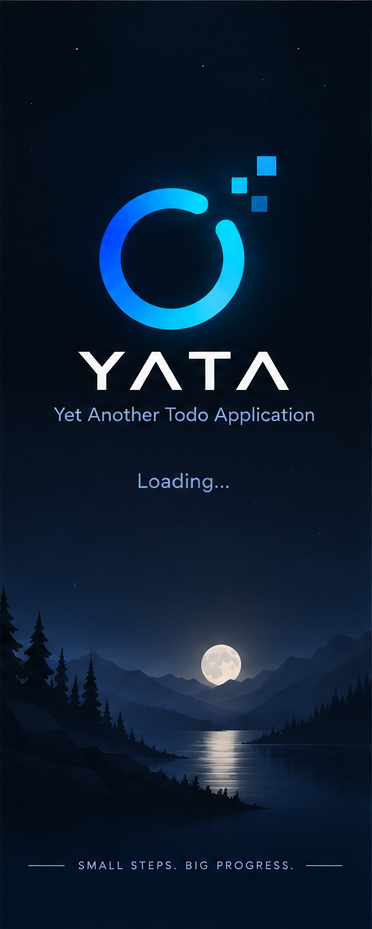
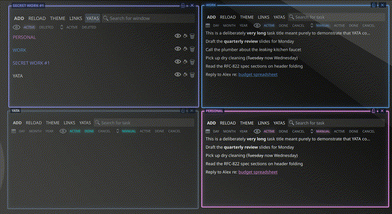

# YATA - Yet Another Todo Application

[](LICENSE)

<p align="center">
  
  
</p>

Simple TODO lists in sticky windows glued to the desktop (like sticky
notes). Every window is its own independent list.

Besides my desire to have simple TODO application, the UI/UX feeling was inspired
by [Awesome WM](https://awesomewm.org/) and [conky](https://github.com/brndnmtthws/conky).

## Features

- **Multiple independent sticky windows**, each pinned below other app
  windows on the desktop, remembering its own position and size — add,
  rename, hide/show or delete windows via the YATAS view ("Y" in the
  window's border bar), each with its own settings and an optional
  custom border/glow color
- Drag a task from one window onto another to move it there
- **Theming** per window via the settings view ("S" in the border bar):
  Dark/Light look, or one of four CRT/terminal tints (Green, Goldenrod,
  White, Black), plus adjustable window opacity
- **Zoom** with Ctrl+scroll, Ctrl+= / Ctrl+- and Ctrl+0 (reset); the
  scroll direction can be flipped in the settings view
- A lock icon cycles Unlocked → Auto-locked → Locked, to blur/freeze a
  window's content in place
- No title bar — drag a window by empty toolbar space
- `./run.sh --backup` zips every window's settings and data into a
  timestamped archive

## TODO list

- Add, edit (double-click), cancel, mark done, re-open and delete tasks;
  task text supports basic Markdown (bold, italic, strikethrough,
  inline code, links)
- Reorder manually by dragging or with the arrows in front of each task,
  or sort by status (Active/Done/Cancel),
  with independent status filters and day/Month/Year grouping (calendar
  views show per-day/month status counts)
- Press-and-hold a task's done/cancel icon to attach an optional Markdown
  note explaining the change
- Realtime text search, plus a LINKS view listing every task that
  contains a Markdown link

Under the hood, window content is a plugin. An experimental work
timesheet plugin still exists in the code (and can be picked when
creating a window), but its development is frozen — YATA is meant to do
simple TODO lists only.

## Quick start

```sh
./run.sh
```

Runs YATA behind a startup splash (`x-loader/`, a pure-X11 splash — see
`BUILD.md`) that fades out once every window from this launch is actually
shown; use `./run-yata.sh` instead to skip the splash entirely (faster for
development), or `./run-loader.sh` to preview the splash on its own.

See `BUILD.md` for setup and test instructions.

### Autostart

When started at login, YATA (and its splash) first waits — up to 2
minutes — until the desktop session is fully up: Xwayland, the monitor
layout, the session bus and, on GNOME, the final X11 scale. Starting
earlier can misplace or shrink every window. What it waited for is
logged to the journal:

```sh
journalctl --user -t yata -b
```

### Backing up your data

```sh
./run.sh --backup   # or -b
```

Instead of starting the app, this zips YATA's whole config and data
directories (every window's settings and tasks) into a timestamped
`yb-<date>-<time>.zip` file in the current directory — e.g.
`yb-2026-08-26-18-23.zip`. If a file with that name already exists (e.g.
you ran `--backup` twice in the same minute), a `-1`, `-2`, ... suffix is
added instead of overwriting it.

## AI-assisted development

This project was built with [Claude](https://www.anthropic.com/claude), Anthropic's AI model, as an active development collaborator — writing code, reviewing architecture decisions, and implementing features end-to-end alongside the human author.

## Third-party notices

**Application icon**, **lock icons** (the glass lock feature's
locked/auto-locked/unlocked states), and the **startup loader's** artwork
(the logo and the light/dark mountain-and-lake background) generated by
ChatGPT (OpenAI), steered/iterated on by the author.

**VT323** font by Peter Hull — used for the CRT tint themes.
Copyright 2011 The VT323 Project Authors (peter.hull@oikoi.com).
Licensed under the [SIL Open Font License 1.1](resources/OFL-VT323.txt).

**Toolbar icons** from [the Noun Project](https://thenounproject.com) (the SVGs
bundled in `resources/assets/` have their in-file attribution text stripped
so they render cleanly at icon size — attribution is given here instead, as
required by the Noun Project's license), licensed under
[Creative Commons Attribution (CC BY)](https://help.thenounproject.com/hc/en-us/articles/200509798-What-licenses-do-you-offer-for-icons):
- "Calendar" by Adrien Coquet — `resources/assets/noun-calendar-999730.svg`
- "Visibility" by Ferdinand Partahi Jaya Tambunan — `resources/assets/noun-visibility-5028261.svg`
- "Arrow Up Down" by Nursila — `resources/assets/noun-arrow-up-down-5553937.svg`
- "Search" by Lyhn — `resources/assets/noun-search-2353120.svg`
- "Link" by Design Queen — `resources/assets/noun-link-7985857.svg`
- "Paint Bucket" by Arthur Shlain — `resources/assets/noun-paint-bucket-104334.svg`
- "Notes" by Suharsono — `resources/assets/noun-notes-8410855.svg`
- "Sleep Mode" by IconPai — `resources/assets/noun_SleepMode_7877974.svg`
- "Start" by Larea — `resources/assets/noun_start_3131880.svg`
- "Stop" by Wahyu Adam — `resources/assets/noun_Stop_8389958.svg`
- "Summary" by I Putu Dicky Adi Pranatha — `resources/assets/noun_summary_8078125.svg`
- "Time List" by Iconiqu — `resources/assets/noun_timelist_4046224.svg`
- "Summary" by Adrien Coquet — `resources/assets/noun_summary_8247478.svg`
- "Settings" by Win Ningsih — `resources/assets/noun_Settings_8461059.svg`

## Known limitation

On X11, the window stays below other app windows (and above the desktop
icons layer) via a direct `_NET_WM_STATE_BELOW` EWMH request
(`yata-src/x11_stacking.py`), not Qt's `Qt.WindowStaysOnBottomHint` — that
hint maps to `_NET_WM_WINDOW_TYPE_DESKTOP` on GNOME/Mutter, which places the
window below the desktop background layer itself (invisible), rather than
merely beneath other app windows.

On **Wayland** (GNOME's default session) native Wayland clients can
neither request a stacking layer nor position their own windows, so YATA
runs through **XWayland** instead (`QT_QPA_PLATFORM=xcb;wayland`, set in
`yata-src/main.py`), where both the remembered positions and the
below-other-windows stacking work as on X11. Only if XWayland isn't
available does it fall back to native Wayland, where windows behave like
normal ones (not pinned beneath others, no remembered position).


